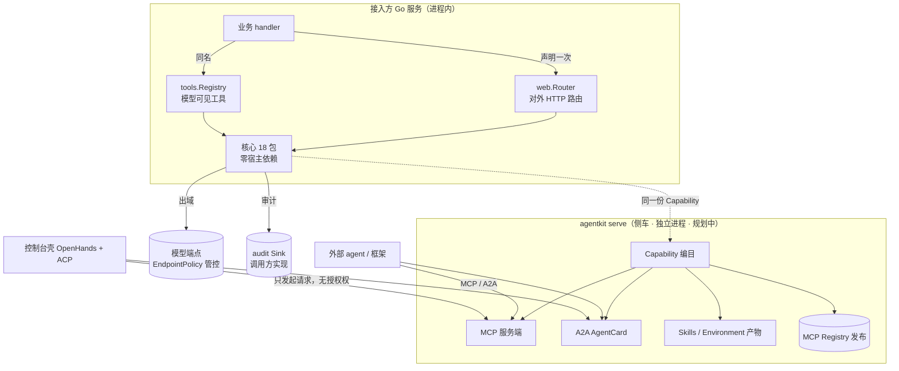

# ARCHITECTURE — agentkit 项目级架构

> 由 `A-architect` 首次建立（模式 A · 首跑）· 2026-10-23
> 上游输入：`.specs/CONTEXT.md`（项目图谱）+ `.specs/agentkit-evolution/ROADMAP.md`（D-discovery 两轮 10 项过审结论）+ 仓库代码实扫
> 本文件是**跨 change 的架构真源**；change 级设计写 `.specs/<change-id>/DESIGN.md`，只有不可逆决策才升到这里成为 ADR。

---

## 1. 系统概览

### 1.1 一句话定位

> **把普通 Go HTTP 服务原地升级为「能力可被 agent 调用、且每个能力都受治理」的平台。**

（AI 起草，待用户背书；若与你的表述不符，我按你的改。）

### 1.2 服务边界图

**边界铁律**：核心（`kit` 及其依赖包）**永远不知道侧车的存在**；侧车依赖核心，反向依赖为零。

### 1.3 关键非功能性指标（NFR 基线）

| 指标 | 现值 | 说明 |
|---|---|---|
| 峰值 QPS | **待测** | 框架本身无服务形态；QPS 取决于接入方 |
| P95 延迟 | **待测** | 只有单点基准（`docs/architecture.md:99` 已登记为未测区） |
| 部署形态 | 单进程 / 无状态 | 核心不落盘、不缓存、无会话 |
| 依赖面 | 1 个第三方（`golang.org/x/sync`） | 硬约束，见 ADR-001 |
| 可用性目标 | 跟随接入方 | 框架不提供 SLA |

> 设计中真正起作用的"非功能约束"是**依赖面**与**无状态**，不是 QPS。

## 2. 模块清单 + 边界

### 2.1 模块表

| 模块 | 路径 | 职责 | 依赖 | 暴露给谁 |
|---|---|---|---|---|
| **核心（现状 18 包）** | | | | |
| 上下文/注入 | `kitctx/` | 请求上下文、Clock/Logger 等注入面 | stdlib | 全核心包 |
| 模型 | `model/`, `modelcfg/` | 协议、端点策略、模型配置 | stdlib | agent/tools/preset |
| 工具 | `tools/` | 注册表 + **唯一授权谓词** + 并行执行 | kitctx/model | kit/agent/scene |
| 语义 | `semantic/` | 自然语言 → 工具选择 | tools | preset |
| 场景/剧本 | `scene/`, `playbook/` | 编排配置 | tools/kitctx | preset |
| 治理 | `security/`, `audit/`, `authz/` | 脱敏/黑名单/围栏/审计/授权 | kitctx | kit/preset |
| 装配 | `kit/`, `preset/` | 组装、生命周期 | 上述全部 | 接入方 / engine |
| 运行 | `agent/`, `engine/`, `session/`, `web/`, `im/` | 循环、驱动、请求装配、HTTP 面、IM 接入 | kitctx 等 | 接入方 |
| 根守卫 | `.`（`guard_test.go`） | 架构约束的可执行判据（D1-D4、依赖口径、身份词表） | AST | CI |
| **平台层（规划中，尚未实现）** | | | | |
| 能力编目 | `capability/`（新） | Capability 描述 + 从 handler/tool 推导 + 多投影 | 核心（只读注册表） | serve |
| MCP 导出 | `mcp/`（新） | `tools/list` / `tools/call` + 导出白名单 | capability | 外部 agent |
| A2A 导出 | `a2a/`（新） | AgentCard 生成（官方 Go SDK） | capability | 外部 agent |
| 老服务扫描 | `tools/scan/`（新） | OpenAPI / Go AST / 运行时自省 → 提案 | 无（纯分析） | serve |
| 侧车 | `cmd/agentkit-serve/`（新） | 单二进制承载编目/导出/扫描/注册 | 平台层 | 运维 |

### 2.2 模块依赖规则（hard rules）

| # | 规则 | 现状 |
|---|---|---|
| R1 | ✅ 核心包只允许 **stdlib + `golang.org/x/sync`** | 0 违例（`go list -deps` 实测） |
| R2 | ✅ `web` 是唯一 D2 入域包；`model` 是唯一 D1 出域包 | 0 违例（`guard_test.go` 判据） |
| R3 | ✅ 授权判定只在 `tools.Registry.LookupAuthorized` 一处 | 0 违例 |
| R4 | ❌ 核心包禁止依赖平台层（`capability`/`mcp`/`a2a`/`serve`） | 尚未存在；**新增时即为红线** |
| R5 | ❌ 平台层禁止绕过授权谓词直接调工具 | 待平台层落地时加守卫 |
| R6 | ❌ 现成件（rea/OpenHands/…）禁止进 `go.mod` | 由 R1 自动覆盖 |

> R4/R5 目前无代码可违例，但**必须在平台层第一个 PR 就加判据**（否则会成为"以后再说"）。

## 3. ADR 列表

### ADR-001 · 依赖面：仅 errgroup 一个第三方

- **状态**：accepted（2026-10-23 首建，来源：initial）
- **取舍**：标准库 / 引入 web 框架 / 引依赖注入容器
- **决定**：核心只用 stdlib + `golang.org/x/sync/errgroup`
- **理由**：可整目录搬走 + 供应链风险最小 + 接入方不需要为框架升级依赖
- **代价**：轮子自己写（HTTP 封装、重试、并行）；生态适配要做在边界而非核心
- **推翻成本**：**高** —— 会连带 ADR-002 的"可搬走"失效
- **判据落地**：`go.mod` 契约测试 + `guard_test.go` 第三方依赖守卫

### ADR-002 · 运行模型：请求内无状态、不做持久化

- **状态**：accepted（initial）
- **取舍**：请求内无状态 / 会话常驻（含 checkpoint、断点恢复）
- **决定**：一次请求一份 `kitctx.RequestContext`；框架不落盘、不做执行快照
- **理由**：可整目录搬走、可嵌入任意 Go 服务、无运维负担
- **代价**：放弃长时任务、断点续跑、跨请求记忆（由接入方自己实现）
- **推翻成本**：**高** —— 需引入存储与状态机，形态从库变平台
- **相关非目标**：图引擎 / durable execution（见 ADR-008）

### ADR-003 · 治理模型：方向分类 + 单一谓词 + fail-closed

- **状态**：accepted（initial；`docs/design.md:6-77`）
- **取舍**：调用方自行鉴权 / 框架内建能力方向分类与授权
- **决定**：D1 出域 `== {model}`、D2 入域 `⊆ {web}`、D3 中立 `⊆ {model,web}`、D4 未归类即违规；授权只在 `LookupAuthorized` 一处；默认拒绝
- **理由**：把"能力越权"变成编译/测试期可判据的问题，而不是运行期祈祷
- **代价**：新增包要显式归类；跨边界能力需绕行注入
- **推翻成本**：**极高** —— 这是本框架的差异化本身

### ADR-004 · 形态：核心不变 + `agentkit serve` 侧车（形态 B）

- **状态**：accepted（2026-10-23，来源：`agentkit-evolution/ROADMAP.md` §7 `platform-positioning`）
- **取舍**：A 纯框架 / **B 框架 + 侧车** / C 一体化平台
- **决定**：核心 18 包保持零依赖可搬走；平台能力（编目/导出/扫描/注册）落 `cmd/agentkit-serve` 单二进制
- **理由**：既要平台能力，又不能拆掉"可嵌入任意 Go 服务"的护城河
- **代价**：两个产物需要解释（库模式 vs 服务模式）；需保证同一套配置与授权
- **推翻成本**：**中** —— 若选 C，需重做部署模型；若回 A，则放弃 6 点愿景

### ADR-005 · 能力模型：单一 Capability + 多投影，禁止第二份手写元数据

- **状态**：accepted（2026-10-23，来源：§7 `capability-model`）
- **取舍**：每协议各写一套描述 / **统一描述 + 投影**
- **决定**：`Capability` 从既有 handler/tool **自动推导**；同一份描述投影出 HTTP / MCP / A2A / Skills / Environment
- **理由**：手写第二份元数据会直接摧毁"接口即工具"的卖点
- **代价**：推导逻辑要覆盖 Go 签名与结构体 tag 的边界情况
- **推翻成本**：**中** —— 投影层可替换，但推导契约会外溢到接入方

### ADR-006 · 导出面治理：白名单 + 出域禁出 + 壳无授权权

- **状态**：accepted（2026-10-23，来源：§7 `protocol-surfaces` + `agent-shell`）
- **取舍**：导出即信任 / **导出单独白名单且默认空**
- **决定**：MCP/A2A 导出面 ⊆ 入域能力；D1 出域能力禁止导出；外部调用仍过 `LookupAuthorized`；控制台壳只能发起请求
- **理由**：导出即提权，必须让"给外部用"成为显式动作而非默认后果
- **代价**：接入方要多维护一张导出白名单
- **推翻成本**：**高** —— 一旦有外部消费者，收缩导出面即破坏兼容

### ADR-007 · 现成件接入策略：只接不并，永不进核心依赖

- **状态**：accepted（2026-10-23，用户原话「有现成的直接接过来就好了」）
- **取舍**：把 rea/OpenHands 等 vendor 进来 / **接口注入或独立进程**
- **决定**：逆向器（rea）作 MCP 客户端接入；控制台（OpenHands）走 ACP/Agent Server；注册中心用 MCP Registry；A2A 引官方 Go SDK 但**隔离在平台层**
- **理由**：既拿到成熟能力，又不破坏 ADR-001 的依赖面
- **代价**：多一层适配代码；上游升级需跟进
- **推翻成本**：**低** —— 适配层可替换

### ADR-008 · 明确非目标：图引擎 / 持久化 / 自研逆向引擎 / 自研 UI / 运行时注入

- **状态**：accepted（2026-10-23，来源：§7 与 §11 否决记录）
- **取舍**：追平竞品能力面 / **只补命脉、不追长时运行**
- **决定**：不做图工作流引擎、不做执行快照与断点恢复、不自研二进制逆向引擎、不自研聊天 UI、不做对运行中进程注入
- **理由**：这些建立在"agent 长时运行"假设上，与 ADR-002 冲突；且已有成熟替代（rea / OpenHands）
- **代价**：长任务场景明确出局，需在文档里说清
- **推翻成本**：**高** —— 会同时冲击 ADR-002/ADR-004

## 4. 跨模块契约

### 4.1 公共 HTTP API

无固定路由表（框架不定义业务 API）。对外契约是**注册协议**：
`web.Registrar`（`web/web.go:242`）声明路由 → `web.Router` 统一中间件/错误映射/状态码。
平台层新增的对外契约：**MCP `tools/list` + `tools/call`**、**A2A AgentCard + JSON-RPC**（规划中）。

### 4.2 事件总线

**无**（进程内无事件总线；`im` 的 Transport 是宿主注入的入站通道）。

### 4.3 数据库 schema

**无**（无状态设计，见 ADR-002）。

### 4.4 共享配置项

| 配置 | 位置 | 语义 |
|---|---|---|
| 模型端点与策略 | `modelcfg/`、`model/endpoint.go` | 允许主机、超时、重试预算 |
| 预设 | `preset/` | 组装 agent/工具/场景的配置 |
| 限额 | `kitctx` `Limits` | 步超时、并行度上限 |
| 平台层（规划） | `capability` 编目 + 导出白名单 | 与核心共用同一份授权语义 |

## 5. 扩展点（Where to plug in new things）

| 扩展点 | 接口 | 位置 |
|---|---|---|
| 日志 / 时钟 | `kitctx.Logger` / `Clock` | `kitctx/inject.go:45` / `:29` |
| 审计落点 | `audit.Sink` / `Closer` | `audit/audit.go:141` / `:155` |
| 出域策略钩子 | `security.Auditor` | `security/egress_policy.go:487` |
| HTTP 出网 | `model.HTTPDoer` | `model/protocol.go:29` |
| DNS/IP 解析 | `model.IPResolver` | `model/endpoint.go:37` |
| HTTP 渲染/注册 | `web.Renderer` / `Registrar` | `web/web.go:177` / `:242` |
| IM 传输/寻址/回复/卡片 | `im.Transport` / `Directory` / `Responder` / `CardCodec` | `im/protocol.go:167` 等 |
| 新增能力 | `tools.Registry` 注册（两阶段） | `tools/registry.go` |

**新增平台层扩展点（规划）**：`capability.Source`（编目来源：注册表 / OpenAPI / AST / MCP 导入）、`mcp.Exporter`、`a2a.CardBuilder`。

## 6. 容量 / 性能边界

| 边界 | 现值 | 何时破 |
|---|---|---|
| 工具并行度 | 按 `kitctx.Limits`，每步独立超时 | 单请求工具过多 → 模型上下文与并发双爆 |
| 单请求模型往返 | 由 agent 循环轮次决定（有终止策略，规划加强） | 轮次失控 → 成本与延迟失控 |
| 端到端吞吐 | **待测** | 上线前必须补回环压测（议题 `e2e-perf-baseline`） |
| 导出面并发 | 未实现 | 侧车上线后需独立容量规划 |

## 7. 已知技术债 + 长期方向

- 技术债见 `.specs/CONTEXT.md` §8.1/§8.2（无 CI、3 包覆盖率缺口、文档悬空指针、端到端性能未测）。
- 长短期方向见 `.specs/agentkit-evolution/ROADMAP.md`：**W0 门禁 → W1.5 DX → W2 可观测 → W3 生态 → W4 编排 → W5 能力编目 → W6 导出 → W7 扫描 → W8 侧车**。
- 架构级风险：平台层（R4/R5）一旦开始实现，必须同步加守卫，否则治理会被"便利"侵蚀。

## 8. 修订历史

| 日期 | 版本 | 变更 | 触发 |
|---|---|---|---|
| 2026-10-23 | v1 | 首次建立：8 段全填 + 8 条 ADR（初始 3 条 + 愿景 5 条） | `A-architect` 首跑，输入为 D-discovery 两轮 10 项过审结论 |
