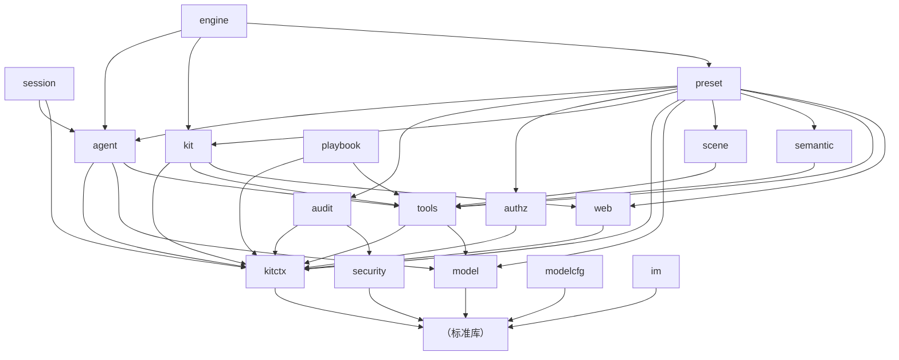

# CONTEXT — agentkit 项目共享上下文（项目图谱）

> 本文件是 I-intel-scan 的产物：**AI 进这个仓库的第一份地图**。每个 change 在 REQUIREMENT 阶段向这里追加术语与决策。
> 生成日期：2026-10-23 · **重扫：2026-10-23（第二轮）** · 扫描口径：`prompts/I-intel-scan.md` 步骤 1.1~1.6（工具：`go list` / `grep` / `go test` / `git log` / `portability_check.py`）
> 重扫触发：`agentkit-framework` change 已归档（`.specs/` 结构变化）、远端由镜像改为单一 `origin`、新增"默认 go 是 1.13"的环境坑需要留痕。
> 本文件**不抄会漂移的数字**（行数 / 用例数）：需要时用文末命令现取。

---

## 0 · 既有文档探测（步骤 0 留痕）

- **探测命中**：
  - `README.md`（158 行，仓库根，框架总览 + 包清单 + 依赖口径 + 抽取步骤）
  - `docs/architecture.md`（99 行，分层图 + 请求路径 + 生命周期 + 基准）
  - `docs/design.md`（89 行，七条不变量 + 决策代价 + 失败语义表 + 测试纪律）
  - `docs/guide.md`（108 行，五句起服务 + 扩展点表 + 报错定位表）
  - `doc.go`（18 行，包注释：零宿主依赖 + 唯一第三方 errgroup）
- **未命中**：`CONTEXT.md`(本文件除外) / `AGENTS.md` / `CLAUDE.md` / `.cursor/rules/*` / `.windsurf/rules/*` / `.github/copilot-instructions.md` / `.clinerules` / `ARCHITECTURE.md` / `CONTRIBUTING.md`
- **用户选择**：分支 B 选项 1 —— 既有文档作扫描补充输入，合并生成 CONTEXT.md（本轮重扫沿用该决策，不再重复询问；用户指令为 `/code-kit 先熟悉扫描这个项目`）
- **决策**：生成 `.specs/CONTEXT.md`（本文件）；`STATE.md → ai_context_doc: .specs/CONTEXT.md`
- **引用源**：
  - 分层与依赖方向 ← `docs/architecture.md:14-55`（本文 §3.2 / §3.3 已按代码 `go list` 复核）
  - 七条不变量与失败语义 ← `docs/design.md:6-77`（本文 §5 / §6）
  - 扩展点与报错定位 ← `docs/guide.md:56-88`（本文 §7）
  - 依赖口径与门禁命令 ← `README.md:67-101`（本文 §5.1）
- **口径冲突登记**（按既有文档自身"以命令输出为准"的约定处理）：
  1. 既有文档中的路径前缀写作 `pkg/agentkit/…` 或 `agentkit/…`（宿主仓库布局）；**本副本的仓库根就是框架根**，所以本文一律写仓库相对路径（如 `kit/kit.go`），对应 `agentkit/kit/kit.go`。
  2. 既有文档引用的 `.specs/adr/…`、`.specs/agent-engine/…` 属**宿主仓库根**的工件，**本副本内不存在**。本副本 `.specs/` 当前实际结构（2026-10-23 重扫实测）：

     | 路径 | 角色 |
     |---|---|
     | `.specs/CONTEXT.md` | 本文件（项目图谱） |
     | `.specs/ALIGNMENT.md` | 五层对齐留痕（首轮基线 `2049508`） |
     | `.specs/LESSONS.md` | 跨任务失败知识库（`L-001`） |
     | `.specs/CHANGELOG.md` | 归档流水（1 行） |
     | `.specs/archive/2026-10-23-agentkit-framework/` | 已归档 change（PRODUCT-DESIGN + 全流程工件） |

     凡遇 `.specs/adr/…` 类指针，按"宿主仓工件、本副本不可解析"处理，不要去找。

## 1 · 项目概要

`agentkit` 是一个**可整目录搬走**的 Go agent 服务框架：把「自然语言请求 → 语义选工具 → 模型出域（脱敏/黑名单/围栏/审计）→ 工具并行执行 → 轨迹与降级 → IM 接入」做成 18 个零宿主依赖的包。宿主只实现注入式接口（日志 / 脱敏 / 时钟 / HTTP 出网 / 实体识别 / IM 传输），框架不 import 任何业务代码。目标用户是**写 Go web 程序的接入方工程师**：他们写普通 handler，声明一次即同时得到对外 HTTP 路由、模型可见工具与权限点（`README.md:11-16`）。

## 2 · 技术栈（团队级默认 / 已锁定）

- **语言/运行时**：Go 1.23.1（`go.mod:3`；实测工具链 go1.26.2）
- ⚠️ **环境坑（2026-10-23 实测）**：本机默认 `PATH` 里的 `go` 是 `/usr/bin/go → go1.13.8`，直接 `go test ./...` 会报
  `model/protocol.go:113:10: undefined: any`（`any` 需 ≥1.18）并连带 15 个包 `[build failed]`。**正确做法**：
  `export PATH=/usr/local/go/bin:$PATH`（go1.26.2）后再跑任何 go 命令；这是环境问题，不是代码回归。
- **模块路径**：`github.com/malizhi2202-dev/agentkit`（`go.mod:1`）
- **前端框架**：无（框架无自带界面；`web/` 只做服务端入口）
- **后端框架**：自研，**无 web 框架依赖**；HTTP 面 = `net/http` 标准库封装（`web/web.go:31`）
- **数据库**：无（无 schema、无迁移；状态由调用方经 `kitctx.RequestContext` 显式携带）
- **测试**：Go 标准库 `testing`（全仓无 testify/mock 依赖，`grep -rn "testify\|mock" --include='*.go'` 零命中）+ `go test -race`
- **构建/部署**：`go build` / `go test`；无 Dockerfile、无 CI 配置文件、无 Makefile（本副本内均未发现）
- **依赖口径（锁死）**：仅标准库 + **唯一**第三方 `golang.org/x/sync/errgroup`（`go.mod:5`；`tools/runner.go:35` 是唯一 import 点）
- **栈卡片编号**：无对应卡片（`@code-kit/reference/tech-stacks.md` 覆盖 Web 应用栈，本仓是 Go 库）

## 3 · 项目图谱

### 3.1 图谱生成口径（可复现）

```bash
go list -f '{{.ImportPath}}|{{join .Imports ","}}' ./...   # 包 × import 明细（本文 §3.2 的唯一来源）
go list ./... | wc -l                                      # 包数
find . -name '*.go' ! -name '*_test.go' | xargs wc -l      # 生产代码规模
grep -rh '^func Test' --include='*_test.go' . | wc -l       # 用例数
```

实测（2026-10-23）：**18 个包**（含根守卫包）、**生产代码 10,641 行**、**测试函数 341 个**、`.go` 文件 82 个（钉表全量）。

### 3.2 包依赖 DAG（内部依赖，由 `go list` 实取）



**无环**（`go list` 全量 import 实取后人工核对）；**零 host-module import**（守卫 `TestGuard_AgentkitNoHostModuleImport`，`guard_test.go:424`）。

### 3.3 分层视图（谁允许依赖谁 · 自上而下）

| 层 | 包 | 一句话职责 | 关键入口（文件:行） |
|---|---|---|---|
| 接入 | `engine` | 总装面：四必需注入点构造期判缺，`Handle` 一句跑完整链 | `engine/engine.go:74` `New` · `:131` `Handle` |
| 接入 | `im` | IM 事件/会话/卡片/网关，零业务 HTTP、零凭据 | `im/gateway.go:242` `NewGateway` |
| 装配 | `preset` | 内置插件全家桶：Perms/Tools/Model/Loop/Server/Planner/Scenes/Audit | `preset/preset.go:262` `Served` · `:247` `Direct` · `:304` `NewTools` |
| 装配 | `kit` | 装配根：插件契约 + 两阶段注册 + 拓扑定序 + 失败逆序回滚 | `kit/plugin.go:23` `Plugin` · `kit/kit.go:91` `New` |
| 编排 | `semantic` | 意图+实体 → 同源工具选择与参数装配（只选不执行） | `semantic/bind.go:149` `NewPlanner` |
| 编排 | `scene` | 场景表按角色裁工具集，被裁逐条留原因 | `scene/scene.go:121` `NewRegistry` |
| 编排 | `playbook` | 剧本预演/执行/逆序补偿，预演零写入 | `playbook/playbook.go:97` `New` |
| 编排 | `session` | 会话记忆**无状态装配点**（纯函数，失败无半成品） | `session/session.go:75` `Assemble` |
| 编排 | `modelcfg` | 模型配置三级兜底（显式>项目>平台）+ 注入探活 | `modelcfg/modelcfg.go:141` `New` |
| 执行 | `agent` | 多轮循环：预算/降级/轨迹 + 记忆四类 + 结论溯源 | `agent/loop.go:113` `NewLoop` · `:124` `LoopOutcome` |
| 判定 | `tools` | 工具注册表 + **唯一授权谓词** + errgroup 并行执行器 | `tools/registry.go:211` `LookupAuthorized` · `tools/runner.go:124` |
| 判定 | `authz` | 权限点声明与值域闭集（**不含授权判定**） | `authz/vocab.go:43` `NewRoleSet` · `authz/registry.go:56` |
| 能力 | `model` | **唯一出域实现**（HTTP 客户端 + 端点策略 + 协议） | `model/client.go:89` `NewClient` · `model/endpoint.go:114` |
| 能力 | `web` | **唯一入域实现**：路由表 + 中间件链 + `ErrKind` 闭集 + `Invoke` 直调 | `web/web.go` · `web/invoke.go` |
| 能力 | `security` | 脱敏 / 不可关黑名单 / 不可信数据围栏 / 出域策略表 | `security/fence.go:76` · `security/egress_policy.go:238` |
| 能力 | `audit` | 审计投递面：先脱敏再扇出，脱敏失败一个 sink 都不碰 | `audit/audit.go:228` `New` |
| 上下文 | `kitctx` | 显式身份/预算/trace/记忆句柄/Clock/Logger + `Digest` | `kitctx/context.go` `RequestContext` |
| 守卫 | 根包 | 方向四档门禁（D1~D4）+ 宿主/第三方依赖基线 | `guard_test.go:586` · `:424` · `:476` |

### 3.4 三次穿行（读图时按这三条走）

1. **一次请求的真实路径**：`web.Handler` 或 `engine.Handle` → `kitctx` 取显式身份/预算/trace → `semantic` 选候选 → `tools.LookupAuthorized` 按角色裁剪 → `agent` 循环（`model` 出域前先过 `security`）→ 工具同表执行（`tools.Runner` errgroup 并行）→ 轨迹 `TraceID+Seq` / 降级标记 → `audit` 扇出（投递前再脱敏一次）。见 `docs/architecture.md:59-66`。
2. **装配与生命周期**：`Declare`（只登记）→ `Deps()` 拓扑定序（书写顺序不决定接线顺序）→ `Apply`（接线 + 注册 `OnStop`）→ 失败逆序回滚 → `Stop()` 钩子 LIFO → 停止后各能力分档拒服务（`Err*NotAssembled` ≠ `Err*Stopped`）。见 `docs/architecture.md:70-76`、`docs/design.md:65-76`。
3. **同一声明产出三件**：`preset.Served(route, sample, perm, handler)` 一次登记 HTTP 路由 + 模型工具 + 权限点，参数 schema 由 `tools.SchemaFor` 反射、所需权限由 schema 反推 ⇒ 接口/工具/权限点三份清单不可能漂移。见 `docs/design.md:20-26`。

### 3.5 门禁与判据面（机械固化的不变量）

| 判据 | 位置 | 断言强度 | 当前状态 |
|---|---|---|---|
| D1 出域符号 | `guard_test.go:684-698` | 包集合 **== {model}**（等号） | ✅ 绿 |
| D2 入域符号 | `guard_test.go:700-712` | 包集合 **⊆ {web}** 且非空 | ✅ 绿 |
| D3 中立符号 | `guard_test.go:715-719` | 包集合 **⊆ {model, web}** | ✅ 绿 |
| D4 未归类即红 | `guard_test.go:676-682` | 逐条违规报红 | ✅ 绿 |
| 宿主零依赖 | `guard_test.go:424` | 框架子树外 import 即红 | ✅ 绿 |
| 第三方白名单 | `guard_test.go:476` | 只许 `golang.org/x/sync/errgroup` | ✅ 绿 |
| 钉定 = 代码全量 | `tools/agentkit_code_pins.py` + `GATE-PINS.md5` | 双向相等 | ✅ 磁盘 82 / 已钉 82，缺口 0 |
| 陌生 module 取走实验 | `tools/portability_check.py` | 临时 module + build/vet/test/-race + 样例十段自校验 | ✅ 绿（2026-10-23 重扫实跑，`J-PORT 通过`） |
| 路径段分类 | `guard_test.go:893` `TestGuard_AgentkitImportClassification` | 两布局逐条判对（23 条子用例） | ✅ 绿（§8.1-1 已收口） |

### 3.6 代码 ↔ 约束的结构性事实

- **唯一授权谓词实现数 = 1**：`tools/registry.go:211`；消费者是 `scene/scene.go:243`、`playbook/playbook.go:176`、`semantic/bind.go:254`（只调不判）。
- **`net/http` 实际 import 面 = `{model, web}`** 加测试文件；`im/`、`preset/` 的 `net/http` 只出现在**注释里的禁令原文**（`im/gateway.go:9`、`preset/preset.go:9`）—— 读图时别误判。
- **零用户状态**：`Engine` 只持 `*kit.Kit` + `*preset.Loop` + 停止位（`engine/engine.go:65-72`）；记忆/身份全由 `Handle(ctx)` 携带。

## 4 · 域语言（术语表）

| 术语 | 定义 |
|---|---|
| **插件（Plugin）** | `{Name, Declare, Apply, Enabled, Deps, Describe}` 六件套；一个能力 = 一个插件，关掉不改代码（`kit/plugin.go:23`） |
| **两阶段注册** | `Declare` 只登记（工具/路由/权限点），`Apply` 才接线并挂停止钩子；装配后再登记 ⇒ `ErrLateDeclare` |
| **装配根（kit）** | 拓扑定序 + Build + 逆序回滚 + Stop 幂等的容器，零用户状态 |
| **同源声明** | 一个业务接口只声明一次，产出 HTTP 路由 / 模型工具 / 权限点三件（`preset.Served`） |
| **唯一授权谓词** | `tools.Registry.LookupAuthorized(name, role)`；返回 `(tool, registered, allowed)` 三态，未注册与越权可分辨 |
| **空角色 ≠ 默认角色** | 未判定角色不放行任何工具，含 `RequiredRoles` 为空的工具（fail-closed） |
| **出域 / 入域** | 出域 = 主动发 HTTP（只许 `model`）；入域 = 对外提供 HTTP（只许 `web`）；判据是**等号基线** |
| **降级（Degraded / StepsLimited）** | 模型不可用 / 步数耗尽时的**非成功非报错**收口：结构结果照常 + 冻结文案 `Notice` |
| **轨迹（Trace）** | `TraceID + Seq` 的步骤序列；缺 `TraceID` 直接拒进循环（不可回放的执行不产生） |
| **围栏（Fence）** | 不可信数据的三条通道闭集包裹，防提示注入 |
| **权限点（PermissionPoint）** | `{Key, Label, Scope, Enforced, DefaultRoles}`；`Scope`/`Enforced` **零值即非法**，无默认 |
| **场景（Scene）** | `{ID, Label, Tools}`：某类问题固定可用哪几个工具；不抄角色、不抄工具清单 |
| **剧本（Playbook）** | 可逆流程：`Step{Args, Compensation}`；预演零写入，执行失败逆序补偿 |
| **记忆装配（Assemble）** | 固定顺序 `Clear→Deletes→Edits→NewItems→Compress` 的纯函数；`Window<=0` ⇒ 不压缩也不虚报 |
| **注入点** | 时钟/日志/HTTPDoer/实体解析/IM 传输/探活：全部由调用方注入，框架不认识厂商协议 |
| **夹具塌缩** | 测试夹具里两套布局/命名空间的常量被写成同值，导致"跨布局必须判违规"的断言自相矛盾；本仓 `6bbec97` 的形态 |
| **框架裁决 / 既有教训 / 验收准则** | 既有文档中引用的**宿主仓决策工件别名**；本副本内不可解析（见 §0 口径冲突 2），不要当成本仓文件去找 |

## 5 · 已锁决策（按时间倒序）

- `[2026-10-23]` 门禁白名单**按 package 精确匹配**，同 module 其它包（如 `golang.org/x/sync/semaphore`）不放行 — `README.md:69-71`
- `[2026-10-23]` 出域基线从 `⊆ {model}` 升级为 **`== {model}` 等号**；D3 中立符号 `⊆ {model, web}`；D4 未归类即红 — `README.md:79-90`
- `[2026-10-23]` 样例程序以 `samples/agentkit-demo.go.txt` 模板存放，**不在仓内建 `cmd/`**：给守卫加豁免等于放宽不变量 — `README.md:47-49`
- `[2026-10-23]` 删除 `tools/registry_test.go` 中重复的布局守卫，守卫职责由根 `guard_test.go` 单一承担（R3 重复实现） — `README.md:135-139`
- `[2026-10-23]` 框架**禁止**做成自带 `go.mod` 的独立子模块；搬运靠「整目录复制 + 一次前缀重写」 — `README.md:151-158`
- `[2026-10-23]` 独立布局的消费方接线区豁免：`cmd/**` 下 `package main` 不受框架中立性管辖（样例 `go run` 实测需要） — `guard_test.go:388-395`
- `[2026-10-23]` `PRODUCT-DESIGN.html` 通过人审门（用户原话「好的同意了」），状态由「起草中」晋级「已过审」，成为 `1-requirement` 上游 — `.specs/agentkit-framework/PRODUCT-DESIGN.html#0`
- `[2026-10-23]` 守卫里的两套布局子树常量**必须不同值**；夹具字面量不得被批量替换成同一命名空间（`6bbec97` 的教训，已写进测试注释 + 运行期自检） — `guard_test.go:893-903`
- `[2026-10-23]` **单一远端策略**：只保留 `origin = git@github.com:malizhi2202-dev/agentkit.git`，删除本地镜像副本（原 `git-mirror`）：多副本是"代码不一致"的根源；一切 fetch/push 直接从工作区对 origin 操作 — `STATE.md` 顶部

## 6 · 默认偏好（AI 缺省按此决策）

- **命名**：包名小写单词（`kitctx`/`modelcfg`）；文件名 snake_case（`egress_policy.go`/`empty_payload.go`）；测试文件 `<原文件>_test.go` 紧邻源码
- **错误处理**：哨兵错误 `ErrXxx` + `errors.Is` 判别；构造期缺项用 `errors.Join` **聚合报全**（`engine/engine.go:74-88`）；未知值**报错而非返回零值**（fail-closed）
- **值域**：每个闭集配 `*Kinds()` / `Valid()`，测试断言**恰等于**期望集合（不是"包含"） — `docs/design.md:80`
- **默认值**：框架**不猜**默认角色/窗口/超时/模型名；缺失就拒或不动 — `docs/design.md:14`
- **注释语言**：中文；禁令与不变量写在被守护符号旁（`preset/preset.go:9` 是范例）
- **测试纪律**：先证判据能红（变异探针）再交付；报告 `^=== RUN` 计数防"空 `-run` 假绿" — `docs/design.md:81`
- **提交格式**：仓库实际历史为中文动宾短句（如「同步宿主：…」「钉表补钉：…」），**未**采用 `<type>(<change-id>)` 形式（R4.1 在此仓未落地，按既有风格写）
- **禁止**：在 `scene`/`playbook`/中间件里比较角色字符串；给 `Limits`/`Window`/角色补默认值；绕过 `model` 发 HTTP — `docs/guide.md:102-108`

## 7 · 既有抽象索引（防 AI 重复实现）

| 能力 | 已有实现 | 入口（文件:行） | 不要重造 |
|---|---|---|---|
| HTTP 出域 | `model.Client`（唯一） | `model/client.go:89` | 任何第二处 `http.Client`/`NewRequest` |
| 端点准入 | `model.EndpointPolicy` | `model/endpoint.go:114` | 自写主机白名单 |
| HTTP 入域 | `web.Router` / `web.Server` / `web.Invoke` | `web/web.go:31` 起 | 自写路由与中间件链 |
| 工具注册与裁剪 | `tools.Registry` | `tools/registry.go:127` | 自写工具表/角色过滤 |
| 并发执行 | `tools.Runner`（errgroup） | `tools/runner.go:92` | 自写 goroutine 池 + 超时 |
| 角色值域 | `authz.RoleSet` | `authz/vocab.go:43` | 硬编码角色字面量（守卫钉住） |
| 权限点表 | `authz.Registry` | `authz/registry.go:56` | 自写权限表 |
| 结构体 → JSON Schema | `tools.SchemaFor` | `tools/schema.go` | 手写 schema |
| 脱敏 | `security.Masker` + `audit` 扇出 | `audit/audit.go:228` | 日志里手写 `mask` 函数 |
| 黑名单 / 围栏 | `security.Blacklist` / `security.Fence` | `security/fence.go:76` | 自写注入防护 |
| 记忆装配 | `session.Assemble` | `session/session.go:75` | 自写四类记忆结构（结构唯一归 `agent`） |
| 摘要 | `kitctx.Digest` | `kitctx/digest.go` | 另写 hash 逻辑 |
| 模型配置兜底 | `modelcfg.Resolver` | `modelcfg/modelcfg.go:141` | 自写优先级链 |
| 装配与回滚 | `kit.Kit` | `kit/kit.go:91` | 自写插件容器/DI |
| IM 卡片分段 | `im` + `StandardCardCodec` | `im/card.go:61` | 自写分段/去重/ACK |

## 8 · 禁动清单（AI 不许"顺手"碰）

> 这些改动会直接打穿等号基线或半迁移，必须走完整 CHANGE → DESIGN → TASK 流程。

- `model/**`（出域唯一出口；新增符号会被 D1/D4 判红）
- `web/**`（入域唯一出口；D2 基线）
- `guard_test.go`（门禁本体；**给守卫加豁免 = 放宽不变量**，需人工背书）
- `GATE-PINS.md5`（钉表；漏钉/幽灵条目都会红，改代码必须同步刷钉）
- `security/egress_policy.go`（出域策略表；公网批准是逐主机显式口子，默认关闭）
- `authz/vocab.go`（角色值域；AST 断言钉住"零角色字面量"）
- `docs/*.md` + `README.md` 中的**不变量措辞**（改措辞即改约定；数字类内容按"命令现取"约定不要抄）

### 8.1 已知问题（本轮扫描实测，未修）

| # | 现象 | 根因（已定位） | 建议修法 | 影响 |
|---|---|---|---|---|
| 1 | ~~`go test ./...` 根包 **FAIL**~~ ✅ **已修复（2026-10-23）**：`TestGuard_AgentkitImportClassification` 曾因 `guardInsideFramework("example.com/hostmod/agentkit","example.com/hostmod/agentkit/model") = true, want false` 常驻红 | 提交 `6bbec97`（"去除不存在的包路径"）把守卫里的 `/pkg/agentkit` **批量替换**为 `/agentkit`，连累 **8 处夹具字面量**：`repoSubtree` 常量、4 条相似前缀（`agentkitfoo` / `agentkitfoo/service` / `agentkit_extra` / `agentkitmodel`）、尾斜杠与 `..` 两条、以及抽取布局最后一条的 path。结果 `repoSubtree` 与 `extractedSubtree` 塌缩成同一命名空间（`guard_test.go:897-898`），"抽取后仓库布局路径已不再是框架子树"这条断言自相矛盾 | 只恢复夹具字面量（仓库布局回到 `<module>/pkg/agentkit`，抽取布局仍 `<module>/agentkit`），**判定函数 `guardInsideFramework` 一行不改**；改完同步刷新 `GATE-PINS.md5` 中 `guard_test.go` 的哈希 | 已收口：`go test ./...` 18/18 包全绿、23 条子用例全 PASS、钉表缺口 0 且哈希一致（见 `REQUIREMENT.md` AC-5/AC-6） |
| 2 | 既有文档大量引用 `.specs/adr/`、`.specs/agent-engine/`、`pkg/agentkit/` 路径与"框架裁决/既有教训/验收准则"别名 | 本副本是宿主仓 `pkg/agentkit/` 的**独立镜像**，`.specs` 不随包走（`README.md:6-9` 已声明该口径） | 读文档时按 §0 口径冲突处理；若要本副本自证，需另建本仓 ADR 索引 | 新人/AI 会尝试打开不存在的路径 |
| 3 | 无 CI 配置、无 Dockerfile、无 Makefile | 本副本未携带宿主 `.gitlab-ci.yml`；门禁目前靠手工跑 `go test` + 两个 py 脚本 | 建议加一个最小 CI（`go test -race ./...` + `agentkit_code_pins.py` + `portability_check.py`） | 门禁"能跑"但"没人自动跑"，回归靠自觉（已登记议题 `ci-minimum-pipeline`） |
| 4 | 默认 `PATH` 的 `go` 是 1.13.8，直接跑测试会假红（`undefined: any`，15 包 build failed） | 系统 `/usr/bin/go` 指向 `go-1.13`；项目 `go.mod` 要求 1.23.1 | 统一 `export PATH=/usr/local/go/bin:$PATH`（或 aliases）；CI 里显式钉 toolchain | 新会话/新人第一次跑测试会误判为代码坏 |

### 8.2 技术债（给 2-design / 4-dev 参考，别再加同类）

| 债项 | 首次发现 | 影响 | 计划 |
|---|---|---|---|
| ~~根守卫夹具布局常量塌缩（§8.1-1）~~ | 2026-10-23 intel-scan | `go test ./...` 曾常驻 1 红 | ✅ 2026-10-23 已收口（`agentkit-framework` change T01：恢复 8 处夹具字面量 + 刷钉表） |
| 文档路径前缀仍按宿主布局书写 | 2026-10-23 intel-scan | 独立副本里出现悬空指针 | 下次文档同步时统一为"仓库相对路径 + 一句宿主口径说明" |
| 端到端 P95 / QPS 未测（只有单点基准） | `docs/architecture.md:99` | 不能拿单点数字冒充端到端延迟 | 明确登记为未验证区，需要时补回环压测 |

## 9 · intel-scan 元数据

- **last_intel_scan**: `2026-10-23`（第二轮重扫，同日）
- **scanner**: `prompts/I-intel-scan.md`（kit 正典 `/home/malizhi/.agents/skills/code-kit/`）
- **本次扫描执行过的命令**：`go list ./...` / `go list -f '{{.ImportPath}}|{{join .Imports ","}}' ./...` / `go test -count=1 ./...`（18 包）/ `go vet` / `python3 tools/agentkit_code_pins.py`（缺口 0）/ `python3 tools/portability_check.py`（J-PORT 通过）/ `gofmt -l .`（空）/ 多组 `grep -rn` / `git log`
- **本轮新增实测**：18 包全绿 · 钉表缺口 0 · portability 判据通过 · 依赖仍只有 `errgroup` · `.specs/` 结构已含 archive/ALIGNMENT/LESSONS/CHANGELOG
- **下次重扫建议触发条件**：包数量变化 / 新增第三方依赖 / `guard_test.go` 基线调整 / 超过 90 天
